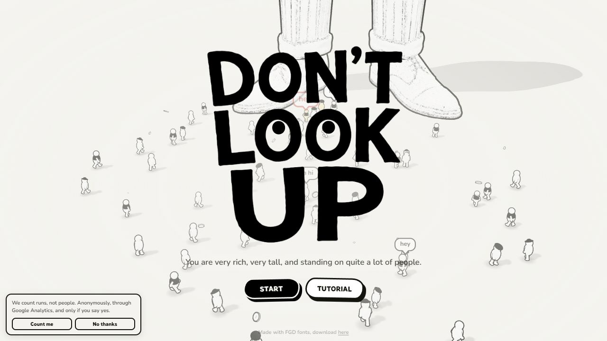
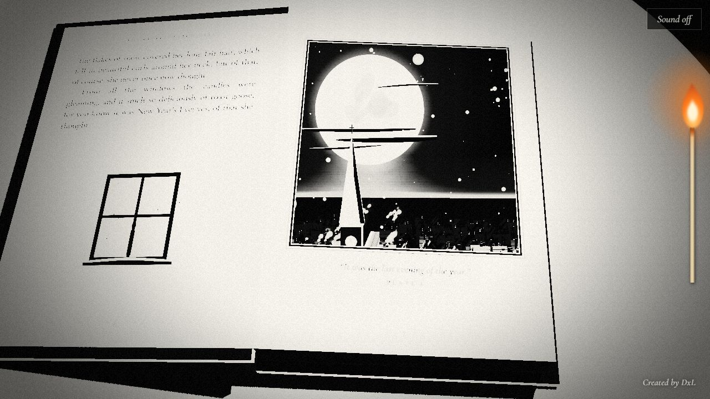
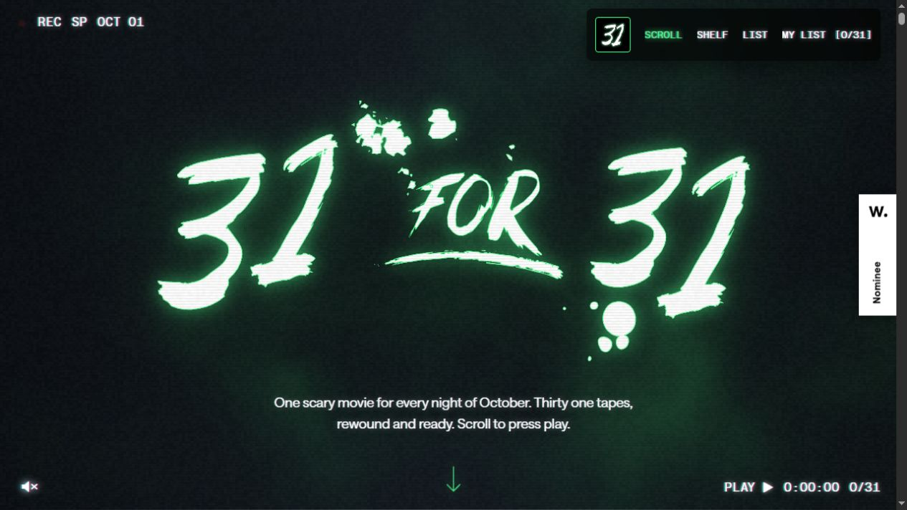
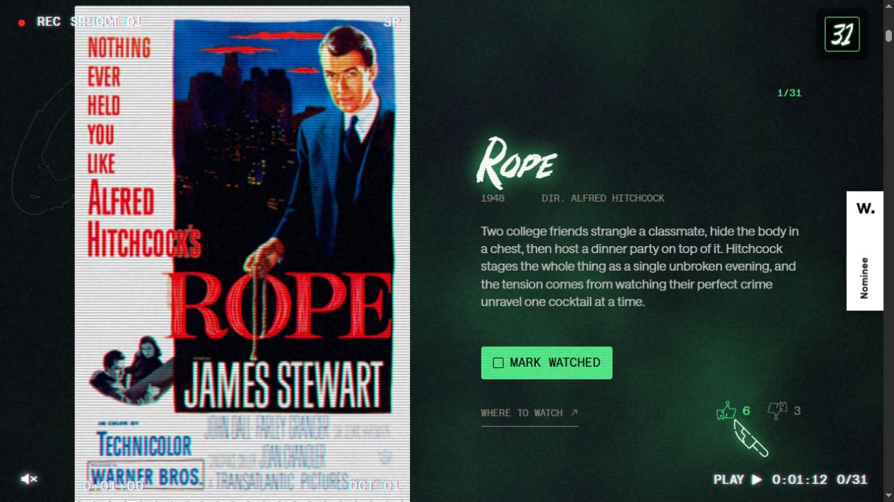
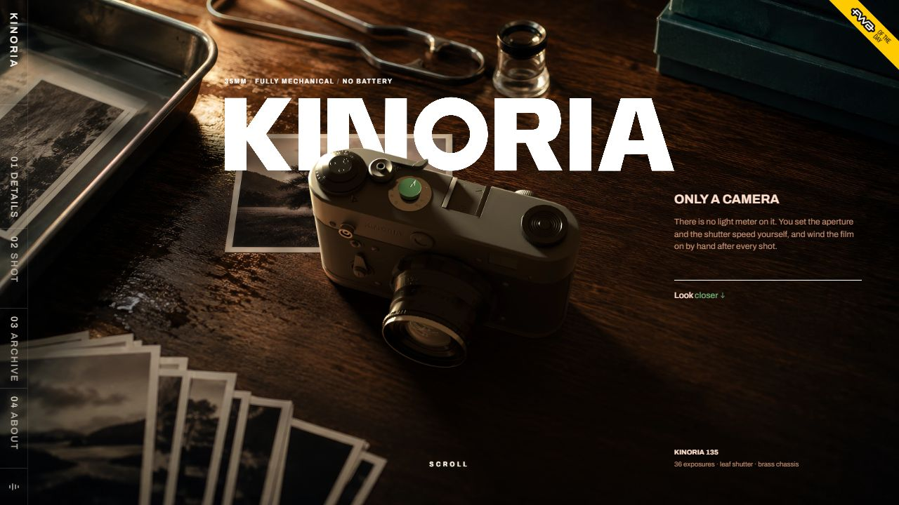
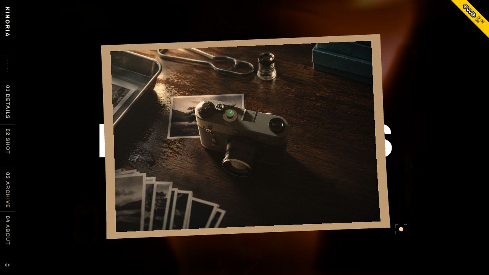
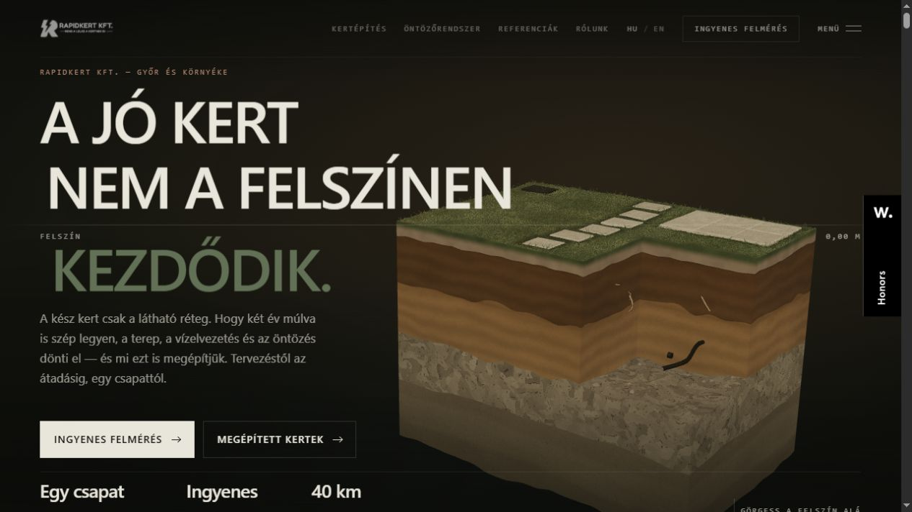
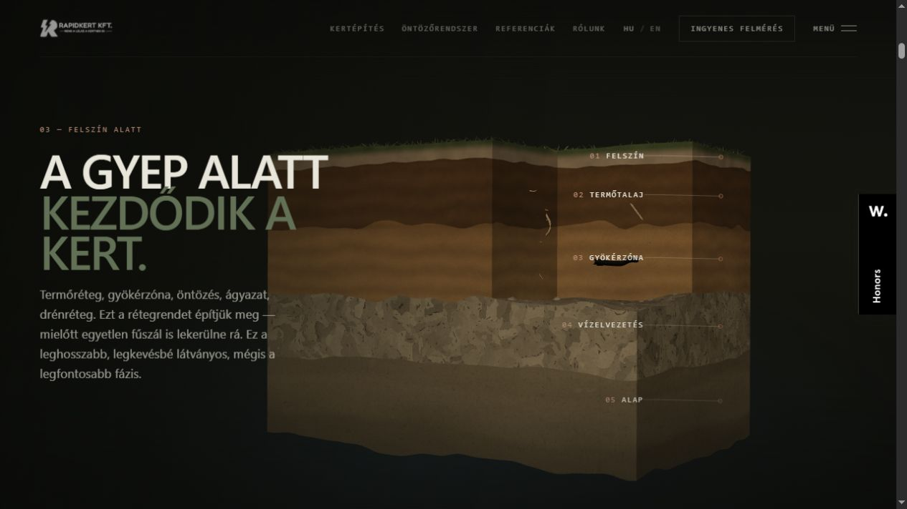
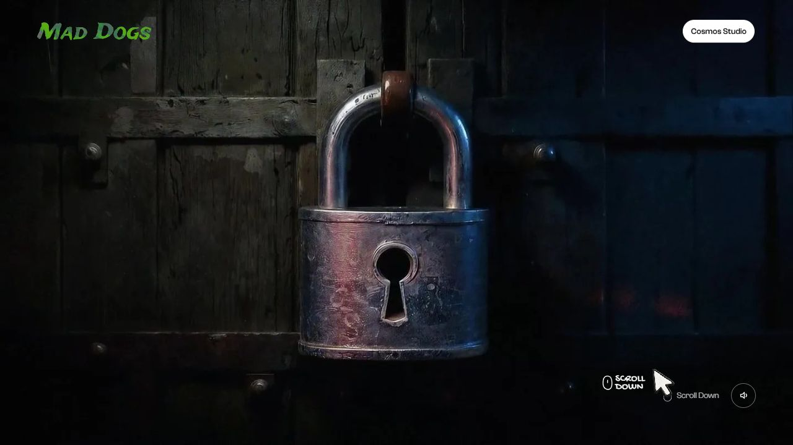

# Referencias visuales — MALA TINTA

Inspección realizada el 3 de noviembre de 2026. Las seis URLs se abrieron en el navegador y se capturaron. Las bibliotecas se distinguen de las inferencias visuales. Las capturas se guardan para estudio y no se incorporan como activos de la web.

## Síntesis para implementar

- Un gesto protagonista por capítulo: personaje que mira al cursor, recorrido de estudio y libreta que pasa páginas. El scroll debe revelar contenido útil y permitir seguir leyendo sin bloquear el desplazamiento.
- Materialidad: papel cálido, tinta negra, metal, cuero y un rojo potente. Evitar cargar seis efectos distintos en el primer viewport.
- Navegación compacta y persistente, con acceso inmediato a los diseños y al contacto. Control de movimiento accesible, contenido HTML y alternativa estática al WebGL.
- No copiar tipografías, ilustraciones o modelos de estos sitios. La paleta y Lora/Raleway del encargo definen la identidad nueva.

## Don't Look Up

Fuente: [dontlookup.app](https://www.dontlookup.app/).

Observado: fondo marfil, dibujo negro irregular, pequeños personajes animados, letras que contienen ojos, botones con contorno y sombra desplazada. La interfaz usa humor y una sola acción dominante. Es un juego, por lo que su estructura completa no corresponde a una página comercial.

Aplicación: mirada reactiva del protagonista, controles como pegatinas, copy breve y desafiante. Conservar controles reconocibles y foco visible.

Tecnología verificada: el bundle público contiene Three.js r170 y GSAP 3.15.0. La mención de Draco en GLTFLoader no demuestra por sí sola que sus modelos estén comprimidos.

## One Cold Night

Fuente: [onecoldnight.com](https://onecoldnight.com/).

Observado: apertura de un libro ilustrado. El scroll cambia páginas tridimensionales; papel granuloso, tinta negra, sombras y una cerilla forman la escena. Existe entrada sin sonido. Se capturó el libro abierto tras desplazarse.

Aplicación: libreta de flash con hojas cálidas, volumen y sombra; paginación con botones como alternativa al scroll.

Tecnología verificada: rutas de salida Astro y bundle con licencia Three.js; el bundle declara revisión 180. No se identificaron GSAP ni Lenis en el bundle principal inspeccionado.

## 31 for 31

Fuente: [31-for-31.com](https://www.31-for-31.com/).

Observado: identidad VHS, ruido/scanlines, verde luminoso, navegación flotante que se contrae, objetos de videoteca y presentación secuencial de películas. Se recorrió desde portada a la primera película.

Aplicación: capítulos numerados, objetos con presencia física y controles persistentes; mantener el grano sutil para no comprometer legibilidad.

Tecnología verificada: su footer acredita modelado de cintas/cajas/reproductor en Blender, escaneo Meshy y Three.js, GSAP y Lenis. El HTML carga GSAP/ScrollTrigger 3.12.5, Lenis 1.1.18 y Lottie 5.12.2.

## Kinoria

Fuente: [kinoria.studio](https://kinoria.studio/).

Observado: cámara y mesa con materiales ricos, luz cálida, fotos físicas, tipografía grande, navegación vertical lateral. El scroll transforma el encuadre en una fotografía flotante. No se necesitó sonido para navegar.

Aplicación: acercamiento cinematográfico al cuero de la silla, acero del carro y botellas de tinta; un capítulo a la vez. El detalle de la escena importa más que acumular objetos.

Tecnología: se observaron módulos JavaScript en /assets/ y una escena de gráficos acelerados. Los comentarios del HTML mencionan Three, pero no se verificó su versión ni la biblioteca del módulo de escena; no se atribuye framework específico.

## Rapidkert

Fuente: [rapidkert.com](https://rapidkert.com/).

Observado: bloque de terreno en perspectiva sobre fondo oscuro, titulares superpuestos y una cámara que desciende para explicar capas. Etiquetas finas unen el texto a las partes del modelo. El resto del sitio vuelve a contenido HTML: trabajos, proceso, FAQ y contacto.

Aplicación: recorrido de estudio con tres paradas, etiquetas de silla/herramientas/preparación y transición posterior a galería y FAQs. Es la referencia más útil para equilibrar inmersión y conversión local.

Tecnología verificada: módulo rk-ground.7f6fe42086.js con código de THREE.WebGLRenderer. El HTML contiene detección de capacidad gráfica y ruta de fallback antes de cargar escena. No se detectó GSAP en el bundle principal inspeccionado.

## Mad Dogs

Fuente: [maddogs.cosmos.studio](https://maddogs.cosmos.studio/).

Observado: puerta de madera y candado de gran tamaño, metal con desgaste, iluminación fría/cálida, navegación mínima y cursor propio. La página expone un canvas de secuencia. El scroll avanzó solo parcialmente en esta sesión; se capturó el candado y su pequeño cambio de posición, no se verificó la secuencia completa de personajes.

Aplicación: dirección artística de materiales y entrada teatral al estudio, con texto HTML y botón para saltar el recorrido. No reproducir una carga larga obligatoria.

Tecnología verificada: Nuxt, integración Prismic y GSAP 3.12.7 en su bundle. El canvas de secuencia no demuestra WebGL ni Three.js; no se atribuyen esas tecnologías.

## Evidencia técnica y límites

- `references/source-audit.json`: scripts y firmas del HTML público.
- `references/tech-evidence.json`: fragmentos breves que identifican bibliotecas en bundles públicos.
- `references/tech-additional.json`: comprobación del módulo Three de Rapidkert.
- El extractor web no pudo leer One Cold Night, 31 for 31 y Mad Dogs, pero el navegador y la lectura HTTP sí funcionaron. Kinoria también se verificó visualmente a pesar del fallback mostrado por el extractor.
- Las versiones corresponden a los archivos servidos durante esta inspección; no son recomendaciones de versiones para el prototipo.
